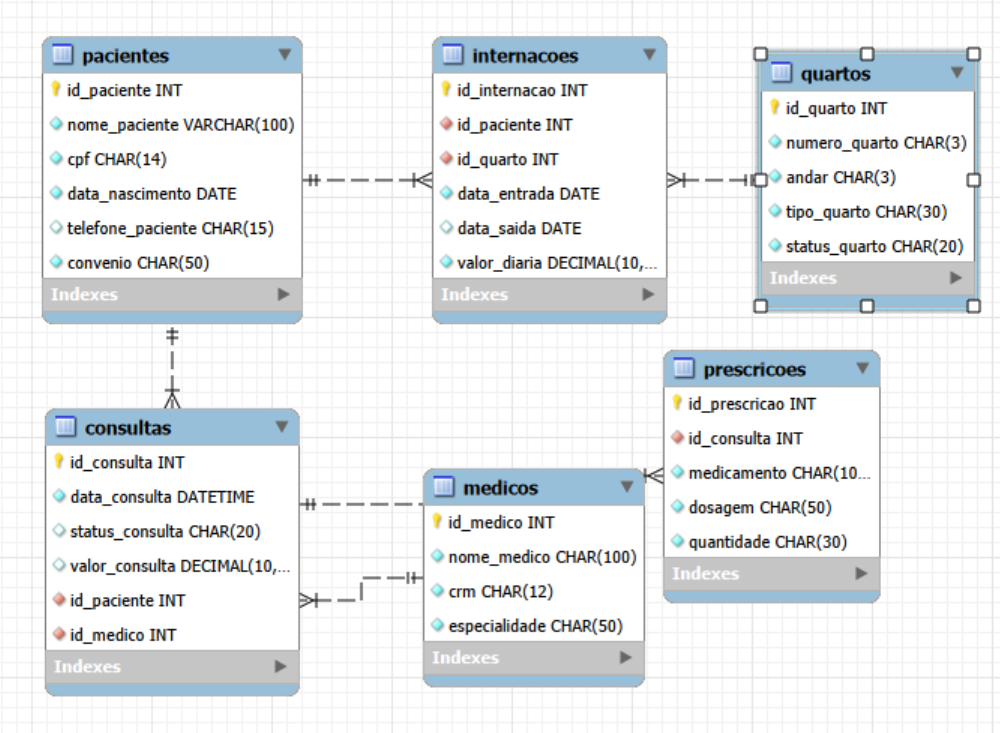
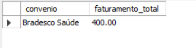
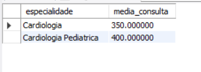
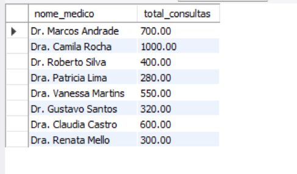
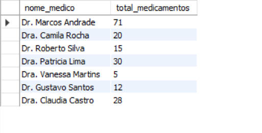
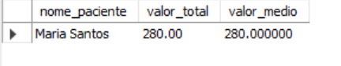
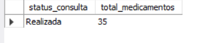
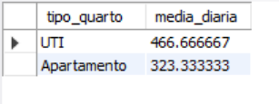
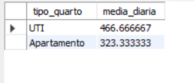

**Hospital-Banco-De-Dados**

**Contextualização-Situação-e-Problema**
O hospital necessita de relatórios gerenciais e financeiros que permitam analisar o 
faturamento das consultas, os valores das internações, as prescrições médicas e os custos por paciente.
Para isso, serão realizadas consultas no banco de dados com filtros e agrupamentos específicos, considerando convênios, 
especialidades médicas, médicos, pacientes, tipos de quartos e status das consultas. Essas informações ajudarão os setores
administrativo, financeiro, clínico e farmacêutico a acompanhar os gastos, avaliar os serviços prestados e tomar decisões mais
eficientes para a gestão hospitalar.

**Modelagem**

**=================================================**

**Métodos-Utilizados(Popularização)**

1- SELECT	Seleciona as informações que serão consultadas.

2- FROM	Define a tabela de onde os dados serão extraídos.

3- INNER JOIN	Relaciona duas ou mais tabelas por meio de uma informação em comum.

4- ON	Define a condição de relacionamento entre as tabelas.

5- WHERE	Filtra os registros de acordo com condições específicas.

6- LIKE	Pesquisa textos que correspondem a determinado padrão.

7- SUM()	Calcula a soma dos valores de uma coluna.

8- AVG()	Calcula a média dos valores de uma coluna.

9- COUNT()	Conta a quantidade de registros.

10- GROUP BY	Agrupa os resultados de acordo com uma ou mais colunas.

11- IN	Verifica se um valor corresponde a algum item de uma lista.

12- OR	Permite utilizar uma condição ou outra na consulta.

13- DATEDIFF()	Calcula a diferença em dias entre duas datas.

14- CAST()	Converte um valor de um tipo de dado para outro.

15- AS	Define um nome alternativo (apelido) para uma coluna ou resultado.

16- UNSIGNED	Define um número inteiro sem valores negativos.

17- *	Seleciona todas as colunas de uma tabela.

**=================================================**

**Cardinalidade(Relacionamentos)**

- Pacientes → Consultas	1:N	Um paciente pode realizar várias consultas, mas cada consulta pertence a um paciente.

- Médicos → Consultas	1:N	Um médico pode realizar várias consultas, mas cada consulta está vinculada a um médico.

- Pacientes → Internações	1:N	Um paciente pode possuir várias internações, mas cada internação pertence a um paciente.

- Quartos → Internações	1:N	Um quarto pode estar relacionado a várias internações ao longo do tempo, mas cada internação ocupa um quarto.

- Consultas → Prescrições	1:N	Uma consulta pode possuir várias prescrições, mas cada prescrição pertence a uma consulta.

**Consultas**

